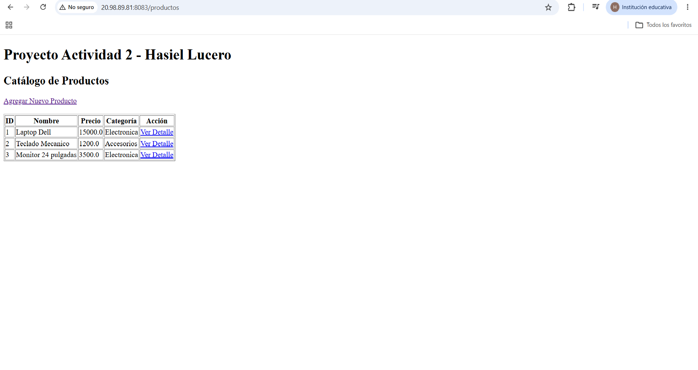
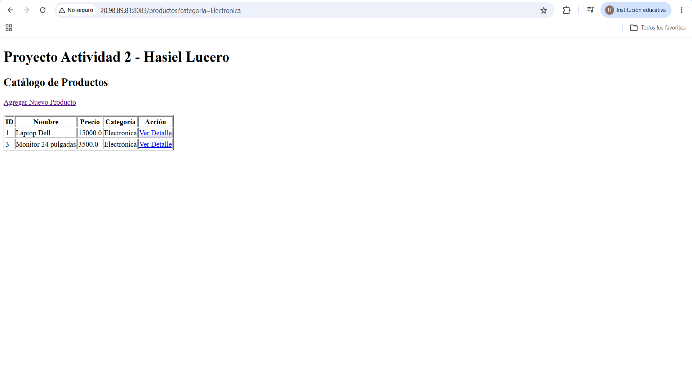
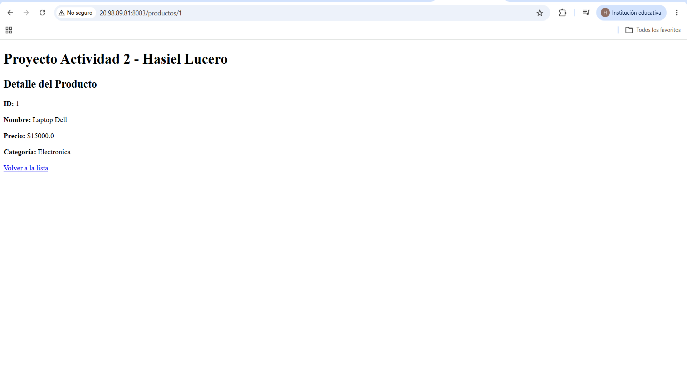
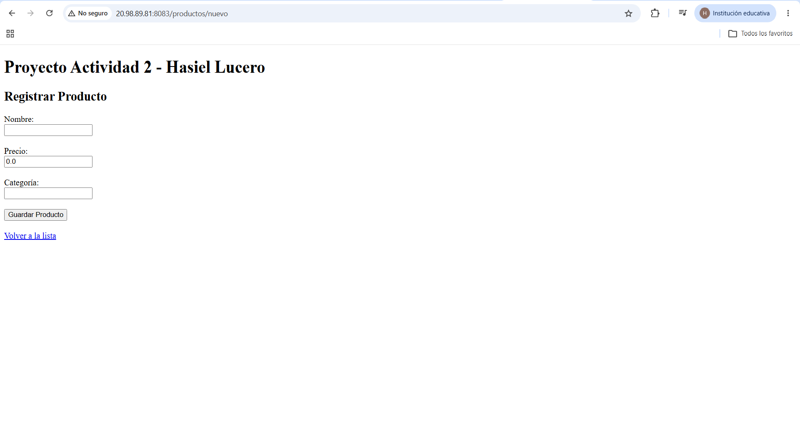

# Actividad 2: Spring MVC - Vistas con Thymeleaf, DTOs y Manejo de Peticiones

**Alumno:** Hasiel Isai Mendoza Lucero  
**Repositorio GitHub:** [HIMLact2_t4](https://github.com/Hasielisaimendozalucero/HIMLact2_t4.git)  
**URL de Despliegue (VPS Azure):** `http://20.98.89.81:8083/productos`  

---

## 🚀 Descripción del Proyecto
Aplicación web desarrollada con **Spring Boot** y **Thymeleaf** que implementa la arquitectura MVC. Gestiona un catálogo de productos haciendo uso de objetos DTO (`ProductoDTO`), inyección de propiedades (`@Value`), mapeo de parámetros de URL (`@RequestParam` y `@PathVariable`), procesamiento de formularios HTML (`@ModelAttribute`) y endpoints REST (`@RequestBody` y `@ResponseBody`).

---

## 📸 Evidencias de Funcionamiento

### 1. Listado de Productos (`th:each` y `@Value`)
Muestra la lista dinámica de productos utilizando Thymeleaf y el título inyectado desde `application.properties`.

### 2. Filtro por Categoría (`@RequestParam`)
Filtrado dinámico de la lista al enviar el parámetro `?categoria=Electronica` en la URL.

### 3. Detalle de Producto (`@PathVariable`)
Consulta individual de la información de un producto mediante su ID en la ruta `/productos/1`.

### 4. Formulario de Registro (`@ModelAttribute`)
Formulario HTML para dar de alta un producto y procesarlo mediante un objeto DTO.

---

## 🛠️ Tecnologías Utilizadas
- Java 17+ / Spring Boot 4.1.2[cite: 2]
- Spring MVC & Thymeleaf[cite: 2]
- Maven Wrapper[cite: 1]
- VPS Microsoft Azure (Ubuntu Linux 24.04)
